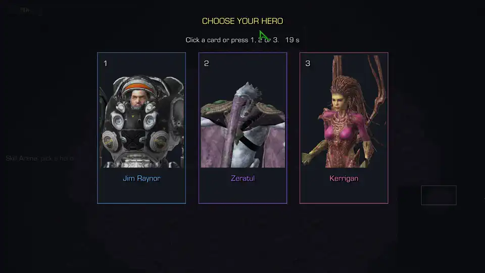

<h1 align="center">
  
  <br>
  SC:R Enhanced
</h1>

<p align="center">편의 기능과 확장 기능을 더한 SC:R 모드.</p>

<p align="center">
  <a href="LICENSE"></a>
</p>

<p align="center"><a href="README.md">English</a> | <b>한국어</b></p>

---

[SC:R 모드](https://github.com/fogofwarlabs/sc4j-scr)를 패치한 별도 SC4J 모드입니다(모드 id `scr-enhanced`, jar `scr-enhanced.jar`). 스타크래프트: 리마스터가 필요합니다. 게임 데이터는 플레이어 본인의 설치본에서 읽습니다.

- [기능](#기능)
- [구성](#구성)
- [복제와 오버레이](#복제와-오버레이)
- [빌드와 실행](#빌드와-실행)
- [라이선스](#라이선스)

## 기능

### 1. 고속 맵 전송

모든 플레이어가 SC:R Enhanced인 Beacon.Link 방에서는 로비 맵을 SC4J 엔진의 전송으로 받아, 스타크래프트의 맵 전송보다 빠릅니다. 다른 방은 스타크래프트의 맵 전송을 씁니다.

### 2. 대용량 맵

스타크래프트는 `scenario.chk`가 256 MiB보다 큰 맵을 거부하지만, SC:R Enhanced는 2 GiB까지 읽으므로 EUD GRP와 anim을 많이 담은 맵도 플레이할 수 있습니다.

모든 플레이어가 SC:R Enhanced인 Beacon.Link 방에서는 이런 맵도 고속 맵 전송으로 받습니다.

### 3. EUD GRP


1.16처럼 EUD 맵이 메모리에 쓴 GRP를 그립니다. GRP 주소를 이미지 GRP 테이블(`0x51CED0 + 4 * 이미지 id`)이나 이미지의 GRP 포인터(`+0x2C`)에 씁니다. 이미지 N의 테이블 항목을 복사하면 이미지 N의 설치된 그래픽을 그립니다.

맵이 메모리에 쓴 자원 아이콘, 지형 그림, 게임 화면 픽셀도 그리고, 콘솔은 맵이 바꾼 다이얼로그와 컨트롤의 배치와 투명도를 따릅니다.

### 4. EUD ANIM


EUD 맵이 HD와 HD2 그래픽을 SC:R anim으로 바꿀 수 있습니다. EUD GRP에서 GRP 주소를 쓰는 곳에 anim 주소를 씁니다. anim은 `ANIM` 헤더, 배율 4(HD) 또는 2(HD2)의 항목 하나, anim 캔버스에 놓인 프레임, DXT1, DXT3, DXT5 중 하나인 `diffuse` 레이어를 가집니다. `teamcolor`와 조명 레이어는 없어도 됩니다.

클래식 그래픽용 GRP도 주려면 GRP 주소를 쓰고 GRP 바로 앞 12바이트에 `HDAN`, HD anim과 HD2 anim의 GRP 기준 오프셋(없으면 `0`)을 둡니다.

HD는 HD anim을, 없으면 HD2 anim을 그립니다. HD2는 HD2 anim을, 없으면 HD anim을 절반 크기로 그립니다. 프레임 번호는 GRP의 번호입니다.

스타크래프트: 리마스터와 SC:R 모드는 이 쓰기를 무시하고 원래 그래픽을 보여 줍니다.

### 5. Enhanced Script

맵에 JavaScript(또는 JavaScript로 컴파일한 TypeScript)를 담아 모든 플레이어의 게임에서 락스텝으로 실행할 수 있습니다. 프레임, 이벤트, 입력 훅, 타이머, 화면 그리기, 커맨드 카드 버튼, 유닛과 플레이어와 게임 데이터 접근을 제공합니다.



```js
game.every(Time.fromSeconds(30), () => {
    game.players.getHumans().forEach((player) => player.addMinerals(50));
});

/** @param {UnitDiedEvent} event */
function onUnitDied(event) {
    game.print(event.getUnitType().getName() + ' died.');
}
```

가이드: [Enhanced Script](docs/script.ko.md).

### 6. 번역

다른 플레이어의 채팅과 맵의 텍스트를 SC4J 엔진의 번역기로 번역해 텍스트 언어로 보여 줍니다(설정 `채팅 번역`, `맵 텍스트 번역`).

요청마다 채팅인지 맵 텍스트인지 알리고 용어집을 줍니다. 용어집은 스타크래프트: 리마스터 설치본에 있는 모든 게임 언어의 유닛, 건물, 업그레이드, 기술 이름과 자주 쓰는 플레이어 용어([`slang.json`](src/mod/resources/org/fogofwarlabs/sc4j/screnhanced/translation/slang.json))입니다.

## 구성

| 경로 | 내용 |
|---|---|
| `scr/` | SC:R 모드, [sc4j-scr](https://github.com/fogofwarlabs/sc4j-scr)의 git 서브모듈 |
| `overlay/` | 복제한 소스를 대신하거나 더하는 파일(`overlay/<module>/src/main/...`) |
| `overlay.lock`, `overlay-base/` | 오버레이 파일의 기준인 SC:R 모드 파일 각각의 SHA-256과 복사본 |
| `src/clone` | 복제 도구(빌드할 때만) |
| `src/mod` | 모드 자체의 클래스와 리소스 |
| `src/test` | 테스트. 빌드한 jar를 읽음 |

설정, 저장 폴더, 로그, 런처 그림([브랜딩](docs/branding/README.ko.md))은 따로입니다. 스타크래프트: 리마스터 폴더 설정은 SC:R 모드와 같고, `scr.jar` 없이 실행됩니다.

## 복제와 오버레이

| 작업 | 하는 일 |
|---|---|
| `cloneScrMod` | `overlay.lock`을 확인하고, SC:R 모드 모듈마다 `src/main`을 `build/clone`에 복사한 뒤 `overlay/`를 덮어씀 |
| `overlayDiff` | 오버레이 아래 파일에 대한 SC:R 모드의 변경을 보여 줌 |
| `acceptOverlay` | 현재 SC:R 모드 파일을 `overlay.lock`과 `overlay-base/`에 기록 |

오버레이가 대신하는 파일을 SC:R 모드가 바꾸면 빌드가 멈추고 그 파일을 알려 줍니다. `overlayDiff`를 실행하고, 변경을 오버레이 파일에 병합하고, `acceptOverlay`를 실행합니다.

## 빌드와 실행

JDK 25가 필요합니다. 명령은 저장소 루트에서 실행합니다. Linux와 macOS에서는 `.\gradlew.bat` 대신 `./gradlew`를 쓰고 경로의 `\`를 `/`로 씁니다(`../sc4j/gradlew -p ../sc4j devInstall`).

```powershell
git clone --recurse-submodules https://github.com/fogofwarlabs/sc4j-scr-enhanced.git
cd sc4j-scr-enhanced
.\gradlew.bat build
```

엔진 버전은 `scr/gradle.properties`에서 가져옵니다. `../sc4j`(또는 `-Psc4j.engine.dir=<폴더>`)에 엔진 체크아웃이 있으면 Maven Central 대신 그것을 쓰고, `-Psc4j.engine.local=false`로 끕니다.

SC:R 모드를 갱신하려면 `git submodule update --remote scr`로 받고, 빌드하고, 멈춘 오버레이 파일을 병합하고, `scr`를 `overlay/`, `overlay.lock`, `overlay-base/`와 함께 커밋합니다.

| 명령 | 하는 일 |
|---|---|
| `.\gradlew.bat jar` | `build/libs/scr-enhanced.jar` |
| `.\gradlew.bat test` | 설치본이 필요 없는 테스트 |
| `.\gradlew.bat integrationTest` | 설치본이 필요한 테스트(`sc4j.data`) |
| `..\sc4j\gradlew.bat -p ..\sc4j devInstall` | 엔진 개발용 설치본 `../sc4j/build/dev-install/` |
| `.\gradlew.bat installMod` | jar를 그 설치본 또는 `-Psc4j.install=<폴더>`의 `mods/`에 복사 |
| `.\gradlew.bat run` | 그 설치본의 사용자 데이터로 jar 실행 |
| `..\sc4j\gradlew.bat -p ..\sc4j runDevLauncher` | 개발용 설치본의 런처 열기 |

## 라이선스

[Apache License 2.0](LICENSE). 서드파티 자료: [NOTICE](NOTICE), [`licenses/`](licenses/).

모드 jar에는 맵 스크립트 엔진 [Rhino](https://github.com/mozilla/rhino)가 Mozilla Public License 2.0([`licenses/MPL-2.0.txt`](licenses/MPL-2.0.txt))으로 들어 있습니다.

StarCraft는 Blizzard Entertainment, Inc.의 상표입니다. SC4J는 Blizzard Entertainment와 제휴하거나 승인받지 않았습니다.
