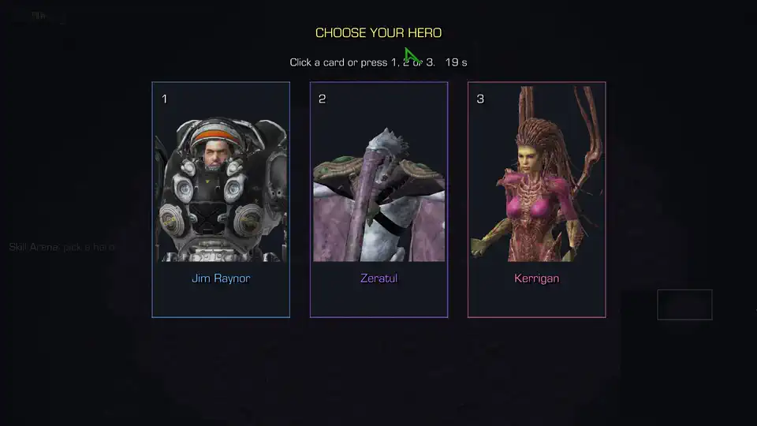

<h1 align="center">
  
  <br>
  SC:R Enhanced
</h1>

<p align="center">The SC:R mod with convenience and extension features.</p>

<p align="center">
  <a href="LICENSE"></a>
</p>

<p align="center"><b>English</b> | <a href="README.ko.md">한국어</a></p>

---

A patch of the [SC:R mod](https://github.com/fogofwarlabs/sc4j-scr) as its own SC4J mod (mod id `scr-enhanced`, jar `scr-enhanced.jar`). It needs StarCraft: Remastered: it reads the game data from the player's own installation.

- [Features](#features)
- [Layout](#layout)
- [Clone and overlay](#clone-and-overlay)
- [Build and run](#build-and-run)
- [Licence](#licence)

## Features

### 1. Fast map download

In a Beacon.Link room where every player runs SC:R Enhanced, the lobby map arrives through the SC4J engine's transfer, faster than StarCraft's map transfer. Other rooms keep StarCraft's map transfer.

### 2. Large maps

StarCraft refuses a map whose `scenario.chk` is larger than 256 MiB; SC:R Enhanced reads it up to 2 GiB, so maps that carry many EUD GRPs and anims play.

In a Beacon.Link room where every player runs SC:R Enhanced, fast map download sends these maps too.

### 3. EUD GRP


As in 1.16, an EUD map draws the GRP it writes to memory: write the GRP's address to the image GRP table (`0x51CED0 + 4 * image id`) or to an image's GRP pointer (`+0x2C`). Copying image N's table entry draws image N's installed graphics.

It also draws the resource icons, terrain pictures and game screen pixels a map writes to memory, and the console follows the layout of the dialogs and controls and the transparency a map changes.

### 4. EUD ANIM


An EUD map can replace HD and HD2 graphics with SC:R anims: write the anim's address where EUD GRP takes a GRP's address. The anim has an `ANIM` header, one entry of scale 4 (HD) or 2 (HD2), frames placed on the anim canvas and a `diffuse` layer in DXT1, DXT3 or DXT5; `teamcolor` and the lighting layers are optional.

To give a GRP for the classic graphics too, write the GRP's address and put 12 bytes right before the GRP: `HDAN`, then the offsets of the HD anim and the HD2 anim from the GRP (`0` for none).

HD draws the HD anim, else the HD2 anim; HD2 draws the HD2 anim, else the HD anim at half size. Frame numbers are the GRP's.

StarCraft: Remastered and the SC:R mod ignore these writes and show the original graphics.

### 5. Enhanced Script

A map can carry JavaScript (or TypeScript compiled to it) that runs on every player's game in lockstep: hooks for frames, events and input, timers, screen drawing, command card buttons, and access to units, players and the game data.



```js
game.every(Time.fromSeconds(30), () => {
    game.players.getHumans().forEach((player) => player.addMinerals(50));
});

/** @param {UnitDiedEvent} event */
function onUnitDied(event) {
    game.print(event.getUnitType().getName() + ' died.');
}
```

Guide: [Enhanced Script](docs/script.md).

### 6. Translation

Other players' chat and the texts of maps are shown in the text language, translated by the SC4J engine's translator (settings `Translate chat` and `Translate map texts`).

Each request tells the translator whether the text is chat or a map text and gives a glossary: the names of units, buildings, upgrades and technologies in every game language the StarCraft: Remastered installation has, and common player terms ([`slang.json`](src/mod/resources/org/fogofwarlabs/sc4j/screnhanced/translation/slang.json)).

## Layout

| Path | Contents |
|---|---|
| `scr/` | the SC:R mod, git submodule of [sc4j-scr](https://github.com/fogofwarlabs/sc4j-scr) |
| `overlay/` | files that replace or add to the cloned sources (`overlay/<module>/src/main/...`) |
| `overlay.lock`, `overlay-base/` | SHA-256 and copy of each SC:R mod file an overlay file is based on |
| `src/clone` | clone tool (build time only) |
| `src/mod` | the mod's own classes and resources |
| `src/test` | tests; they read the built jars |

The mod has its own settings, storage, logs and launcher art ([branding](docs/branding/README.md)). It shares the StarCraft: Remastered folder setting with the SC:R mod and runs without `scr.jar`.

## Clone and overlay

| Task | What it does |
|---|---|
| `cloneScrMod` | checks `overlay.lock`, copies `src/main` of every SC:R mod module into `build/clone`, then `overlay/` over it |
| `overlayDiff` | shows the SC:R mod's changes to files under the overlay |
| `acceptOverlay` | records the current SC:R mod files in `overlay.lock` and `overlay-base/` |

When the SC:R mod changes a file the overlay replaces, the build stops and names it: run `overlayDiff`, merge the change into the overlay file, run `acceptOverlay`.

## Build and run

Needs JDK 25. Commands run from the repository root. On Linux and macOS write `./gradlew` for `.\gradlew.bat` and `/` for `\` in paths (`../sc4j/gradlew -p ../sc4j devInstall`).

```powershell
git clone --recurse-submodules https://github.com/fogofwarlabs/sc4j-scr-enhanced.git
cd sc4j-scr-enhanced
.\gradlew.bat build
```

The engine version comes from `scr/gradle.properties`. An engine checkout at `../sc4j` (or `-Psc4j.engine.dir=<folder>`) is used instead of Maven Central; `-Psc4j.engine.local=false` turns that off.

To update the SC:R mod: `git submodule update --remote scr`, build, merge any stopped overlay file, and commit `scr` with `overlay/`, `overlay.lock` and `overlay-base/`.

| Command | What it does |
|---|---|
| `.\gradlew.bat jar` | `build/libs/scr-enhanced.jar` |
| `.\gradlew.bat test` | tests without the installation |
| `.\gradlew.bat integrationTest` | tests with the installation (`sc4j.data`) |
| `..\sc4j\gradlew.bat -p ..\sc4j devInstall` | engine development install `../sc4j/build/dev-install/` |
| `.\gradlew.bat installMod` | copies the jar into `mods/` of that install, or of `-Psc4j.install=<folder>` |
| `.\gradlew.bat run` | runs the jar with the user data of that install |
| `..\sc4j\gradlew.bat -p ..\sc4j runDevLauncher` | opens the launcher of the development install |

## Licence

[Apache License 2.0](LICENSE). Third-party material: [NOTICE](NOTICE), [`licenses/`](licenses/).

The mod jar carries [Rhino](https://github.com/mozilla/rhino), the script engine of map scripts, under the Mozilla Public License 2.0 ([`licenses/MPL-2.0.txt`](licenses/MPL-2.0.txt)).

StarCraft is a trademark of Blizzard Entertainment, Inc. SC4J is not affiliated with or endorsed by Blizzard Entertainment.
